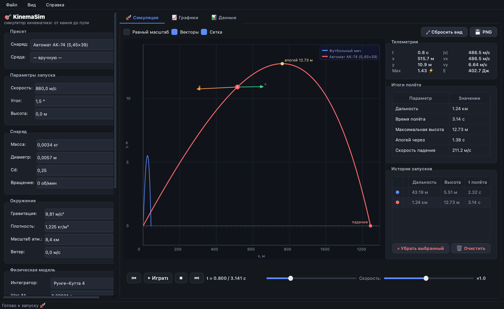

# 🎯 KinemaSim

Симулятор и визуализация кинематики: от брошенного камня до выстрела снайперской винтовки.
PySide6, интерфейс в `.ui` файлах, собственный рендер графиков на QPainter, без тяжёлых зависимостей.



## Возможности

- **Физика**: сила тяжести, квадратичное сопротивление воздуха, экспоненциальное
  падение плотности атмосферы с высотой, ветер (встречный/попутный), эффект Магнуса
  (подъёмная сила от вращения — backspin/topspin), сила Архимеда, отскоки от земли
  с настраиваемой упругостью.
- **Три интегратора**: Эйлер (полунеявный), Верле и Рунге–Кутта 4 — можно сравнить точность.
- **Пресеты снарядов**: камень, футбольный/теннисный/бейсбольный мяч, мяч для гольфа,
  стрела арбалета, пейнтбол, airsoft, пистолет 9×19, АК-74, .338 Lapua, пушечное ядро.
- **Пресеты сред**: Земля (уровень моря и высокогорье), Луна, Марс, Юпитер.
- **Проигрывание полёта**: играть/пауза/стоп/шаг, прокрутка времени, скорость 0.05×–50×,
  векторы скорости и ускорения на снаряде, живая телеметрия (включая число Маха и энергию).
- **Сравнение запусков**: история полётов, наложение траекторий, графики
  высоты/скорости/энергии/ускорения по времени, таблица данных с экспортом в CSV.
- **Цель**: вертикальная мишень на заданной дистанции — попадание/промах и отклонение.
- **Экспорт**: график в PNG, данные полёта в CSV, настройки в JSON.

## Запуск

```bash
python3 -m venv env
env/bin/python -m pip install -r requirements.txt   # Windows: env\Scripts\python ...
env/bin/python src/main.py
```

Проверка физики (сходится с аналитикой в вакууме):

```bash
env/bin/python tests/test_engine.py
```

## Управление

| Действие | Управление |
|---|---|
| Запустить симуляцию | `Enter` или кнопка 🚀 |
| Играть / пауза | `Пробел` |
| Шаг вперёд / назад | `→` / `←` |
| Зум графика | колесо мыши |
| Сдвиг графика | ЛКМ + движение |
| Сброс вида | двойной клик или `Ctrl+R` |

Наведите курсор на траекторию — в статусной строке появятся `t`, `x` и `y` в этой точке.

## Структура

```
KinemaSim/
├── src/
│   ├── main.py                    # класс App + входная точка (argparse: --config)
│   ├── ui_loader.py               # загрузчик .ui (как в MacLearn) + resource_path
│   ├── physics/
│   │   ├── config.py              # SimulationConfig (dataclass, все параметры)
│   │   ├── presets.py             # пресеты снарядов и сред
│   │   └── engine.py              # интеграторы, силы, simulate(), итоги полёта
│   ├── interface_module/
│   │   ├── window.py              # MainWindowUI, панели, проигрывание
│   │   ├── chart.py               # ChartWidget: оси, зум, кроссхэйр, маркеры
│   │   └── uis/                   # все .ui файлы
│   └── resources/style.qss        # тёмная тема
├── tests/                         # самопроверка движка + offscreen-скриншоты
└── scripts/                       # сборка onefile
```

## Физическая модель

Уравнение движения (2D, ось Y вверх): `m·a = F_тяж + F_сопр + F_Магнус + F_Архимеда`

- **Сопротивление**: `F = -½·ρ(h)·Cd·A·|v_rel|²·v̂_rel`, где `v_rel = v − v_ветра`,
  `A = π·(d/2)²`, плотность `ρ(h) = ρ₀·e^(−h/H)`.
- **Магнус**: `F = ½·ρ·Cl·A·|v_rel|²·n̂`, `Cl = S/(2+S)`, `S = r·ω/|v_rel|`;
  вращение > 0 — backspin (сила вверх), < 0 — topspin.
- **Архимед**: `F = ρ(h)·g·V` (снаряд — шар).
- **Земля** на `y = 0`: момент касания интерполируется, при включённых отскоках
  `vy → −vy·e`, `vx → vx·0.98`.

## Сборка (onefile)

- **macOS**: `scripts/build_macos.sh` → `dist/KinemaSim.app`
- **Windows**: `scripts/build_windows.bat` на любой Windows-машине → `dist/KinemaSim.exe`
- **Windows без машины**: GitHub Actions из `.github/workflows/build.yml` —
  пуш в репозиторий, артефакт `KinemaSim-windows` в Actions. PyInstaller не умеет
  кросс-компиляцию, поэтому `.exe` собирается только под Windows.
